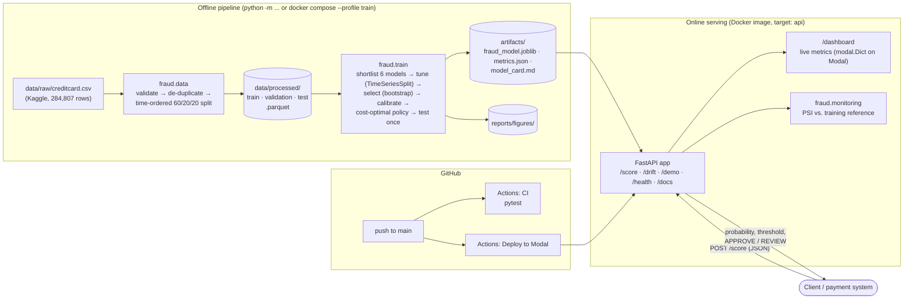
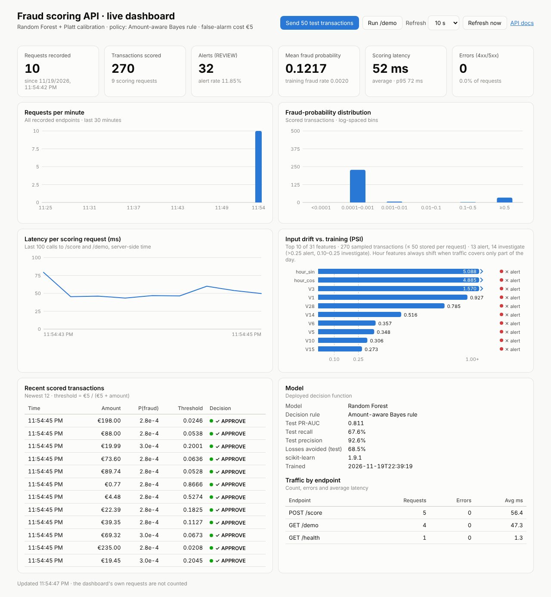

# Credit-Card Fraud Detection: an end-to-end, cost-sensitive ML system

**Millicent Jerotich Kemei, 224097**, DSA 8401 Applied Machine Learning

**Live API:** https://millicentjerotich--fraud-detection-api-fastapi-app.modal.run/docs ·
**Live dashboard:** https://millicentjerotich--fraud-detection-api-fastapi-app.modal.run/dashboard
(technical view: [/dashboard/technical](https://millicentjerotich--fraud-detection-api-fastapi-app.modal.run/dashboard/technical))

A reproducible pipeline that turns the Kaggle credit-card transactions dataset into a deployed fraud-scoring API.
It covers data validation, time-ordered splitting, a shortlist of six model families, tuning, calibrated
probabilities, a **euro-cost-optimal decision rule**, packaging as a FastAPI service in Docker, and drift monitoring.

| Result on the untouched test set (newest 20%, 74 frauds) | Estimate | 95% bootstrap CI |
|---|---|---|
| PR-AUC | **0.811** | 0.727 – 0.888 |
| Recall (frauds caught) | **67.6%** | 55.4% – 78.4% |
| Precision (alerts that are fraud) | **92.6%** | 85.4% – 98.1% |
| Fraud losses avoided vs. no model | **68.5%** | 41.7% – 93.8% |

Model: Random Forest + Platt calibration. Decision rule: flag when P(fraud) ≥ €5 / (€5 + Amount).
The full write-up is in **[reports/REPORT.md](reports/REPORT.md)**.

---

## Contents

- [Architecture](#architecture)
- [Repository layout](#repository-layout)
- [Setup](#setup)
- [Reproduce the project](#reproduce-the-project)
- [Run with Docker](#run-with-docker)
- [Use the API](#use-the-api)
- [Monitoring](#monitoring)
- [Deploy](#deploy)
- [Tests and CI](#tests-and-ci)

## Architecture



**Design choices in one line each** (justified in the report):
- **Time-ordered split**, never random: the model is always evaluated on transactions later than those it learned from.
- **Decision function, not just a model:** the saved bundle contains feature engineering, model, calibration, decision policy, cost parameter and drift reference, so training and serving cannot drift apart.
- **Cost-based decisions:** the alert threshold comes from the cost of mistakes, not from a library default.

## Repository layout

```
├── configs/config.yaml          # all settings: paths, split fractions, costs, tuning, seed
├── src/fraud/                   # the Python package
│   ├── data.py                  #   data pipeline: load → validate → clean → split → save
│   ├── features.py              #   feature engineering shared by training and serving
│   ├── train.py                 #   training, selection, calibration, policy, test evaluation, packaging
│   ├── evaluation.py            #   euro cost model, decision policies, bootstrap
│   ├── monitoring.py            #   Population Stability Index drift checks (CLI too)
│   └── predict.py               #   load the bundle and score transactions
├── app/main.py                  # FastAPI service
├── app/telemetry.py             # request recording + aggregation for the dashboard
├── app/dashboard.html           # Card Fraud Monitor (plain-language dashboard)
├── app/dashboard_technical.html # technical monitoring dashboard
├── artifacts/                   # trained, serialized model + metrics + model card (committed)
├── reports/REPORT.md            # final report; figures in reports/figures/
├── notebooks/                   # exploratory end-to-end notebook (incl. SMOTE and drift experiments)
├── tests/                       # unit + API tests (pytest)
├── Dockerfile                   # multi-stage: target "train" and target "api" (default)
├── docker-compose.yml           # pipeline service (profile "train") + api service
├── modal_app.py                 # serverless deployment on Modal
├── render.yaml                  # alternative deployment on Render
├── .github/workflows/           # ci.yml (tests) · modal-deploy.yml (deploy on push)
├── requirements.txt             # full environment (pipeline, notebook, tests)
├── requirements-api.txt         # serving-only, pinned to the training versions
└── pyproject.toml               # makes `fraud` installable (pip install -e .)
```

## Setup

Requirements: **Python 3.11+** (developed on 3.13) and the dataset.

```bash
git clone https://github.com/MillicentJerotich/CREDIT-FRAUD-AML-EXAM.git
cd CREDIT-FRAUD-AML-EXAM
python -m venv .venv
source .venv/bin/activate          # Windows: .venv\Scripts\activate
pip install -r requirements.txt
pip install -e .                   # makes the `fraud` package importable
```

**Get the data.** The dataset (150 MB) is not committed because GitHub limits files to 100 MB.
Download it from Kaggle, [mlg-ulb/creditcardfraud](https://www.kaggle.com/datasets/mlg-ulb/creditcardfraud),
and save it as `data/raw/creditcard.csv`. With the Kaggle CLI:

```bash
kaggle datasets download -d mlg-ulb/creditcardfraud -p data/raw --unzip
```

The pipeline checks the file before using it: it must have **284,807 rows, 31 columns and no missing values**.
A truncated download or upload fails with a clear message instead of silently producing different results.
SHA-256 of the original file: `76274b691b16a6c49d3f159c883398e03ccd6d1ee12d9d8ee38f4b4b98551a89`.

## Reproduce the project

Two commands rebuild everything from the raw CSV. The run takes about 6 minutes on a laptop.

```bash
python -m fraud.data     # validate, de-duplicate, split by time → data/processed/*.parquet + data_report.json
python -m fraud.train    # train, select, calibrate, choose policy, test → artifacts/ + reports/figures/
```

Expected output of the last lines of `fraud.train` (fixed seed 42, so results are identical on every run with the
pinned library versions):

```
[train] selected Random Forest; vs Tuned HGB: dPR-AUC=+0.013 CI [-0.023, +0.056]
[train] policy chosen on validation: Amount-aware Bayes rule
[train] TEST PR-AUC     0.811  95% CI [0.727, 0.888]
[train] TEST recall     0.676  95% CI [0.554, 0.784]
[train] TEST precision  0.926  95% CI [0.854, 0.981]
```

To change an assumption, edit `configs/config.yaml` and re-run the two commands. For example, set
`costs.false_positive_eur` to the real cost of reviewing a false alarm.

The notebook `notebooks/fraud_detection_end_to_end.ipynb` contains the same analysis with extra exploration:
EDA, the SMOTE experiment and the drift analysis. It was run on Google Colab; change `DATA_PATH` in its
Step 2 to your file location.

## Run with Docker

```bash
# 1. train inside a container (needs data/raw/creditcard.csv); writes artifacts/ and reports/figures/
docker compose --profile train run --rm pipeline

# 2. build and start the API on http://localhost:8000
docker compose up --build api
```

The `api` image already contains the committed model, so step 1 is optional. The API image runs as a non-root user,
has a health check, and only includes serving dependencies.

## Use the API

Open **http://localhost:8000/docs** for interactive documentation.

| Endpoint | Purpose |
|---|---|
| `GET /health` | liveness check |
| `GET /model-info` | model, policy, thresholds, test metrics, library versions |
| `GET /demo` | scores 5 bundled test transactions (3 genuine, 2 real frauds) |
| `POST /score` | scores up to 1,000 transactions |
| `POST /drift` | PSI drift report for a batch (≥ 100 transactions) vs. the training reference |
| `GET /dashboard` | **Card Fraud Monitor**, plain-language dashboard (see below) |
| `GET /dashboard/technical` | technical monitoring dashboard |
| `GET /metrics` | the dashboard's data as JSON |
| `GET /sample-batch?n=50` | random test-set transactions, used by the dashboard's test button |

```bash
curl -X POST http://localhost:8000/score -H "Content-Type: application/json" -d '[{"Time": 0, "V1": -1.36,
  "V2": -0.07, "V3": 2.54, "V4": 1.38, "V5": -0.34, "V6": 0.46, "V7": 0.24, "V8": 0.10, "V9": 0.36, "V10": 0.09,
  "V11": -0.55, "V12": -0.62, "V13": -0.99, "V14": -0.31, "V15": 1.47, "V16": -0.47, "V17": 0.21, "V18": 0.03,
  "V19": 0.40, "V20": 0.25, "V21": -0.02, "V22": 0.28, "V23": -0.11, "V24": 0.07, "V25": 0.13, "V26": -0.19,
  "V27": 0.13, "V28": -0.02, "Amount": 149.62}]'
# → [{"fraud_probability": 0.0003, "threshold": 0.0323, "decision": "APPROVE"}]
```

Without Docker: `uvicorn app.main:app --port 8000`.

## Live dashboard

The running API serves two dashboards that update automatically as the API is used (every call is recorded):

**`/dashboard`: Card Fraud Monitor (plain language, for non-technical readers).**
Payments checked and their value, payments held for review, when payments happen (by hour of day), how risky they
are (low / medium / high / very high risk), the latest held payments with the reason in words, the latest decisions,
simple health checks, and a short glossary.



**`/dashboard/technical`: technical view.** Five status checks, response time, score distribution, input drift
(PSI per feature), traffic by endpoint and the model's test metrics.

**Practice / test traffic vs. real traffic.** The dashboards' send buttons and `/demo` use samples with far more fraud
(about 18% and 40%) than real card traffic (about 0.2%), so their alert rates look high on purpose. Every call is
labelled by source, and the **Show** menu ("Real payments only" / "Real API calls only") hides it.


Storage: locally and in Docker the history is kept in memory (cleared on restart). On Modal it is kept in a
persistent `modal.Dict` named `fraud-api-telemetry`, shared by all containers, so it survives scale-to-zero.
It keeps the last 300 requests: exact totals for every request plus a sample of up to 50 transactions per
request for the table and the drift check. To reset it: `modal dict clear fraud-api-telemetry`.

The dashboard refreshes only while its browser tab is visible. On Modal, an open dashboard tab keeps the
server awake (and using credits), so close it, or set refresh to "off", when you are done.

## Monitoring

```bash
python -m fraud.monitoring data/processed/test.parquet     # or any CSV of new transactions
```

This prints the Population Stability Index for each feature against the training reference stored in the model
bundle. PSI < 0.10 means stable, 0.10–0.25 means investigate, > 0.25 is an alert. The same check is available as
`POST /drift`. See the report for how to read alerts. For example, hour-of-day features always shift when a batch
covers only part of the day.

## Deploy

**Modal (automatic from GitHub).** `.github/workflows/modal-deploy.yml` runs `modal deploy modal_app.py` on every
push to `main`.
1. Create a Modal account, then go to **Settings → API Tokens → New Token**.
2. In GitHub, go to **Settings → Secrets and variables → Actions** and add `MODAL_TOKEN_ID` and `MODAL_TOKEN_SECRET`.
3. Push, or use **Actions → Deploy to Modal → Run workflow**. The deploy log prints the `https://…modal.run` URL.

**Render.** Dashboard → **New → Blueprint** → select the repository (uses `render.yaml` and the Dockerfile).

**Railway.** **New Project → Deploy from GitHub repo**. The Dockerfile is detected automatically. Then go to
**Settings → Networking → Generate Domain**.

## Tests and CI

```bash
pytest -q        # 24 tests: features, data validation, cost model, PSI, API endpoints, dashboards
```

`.github/workflows/ci.yml` runs the tests on every push and pull request.
