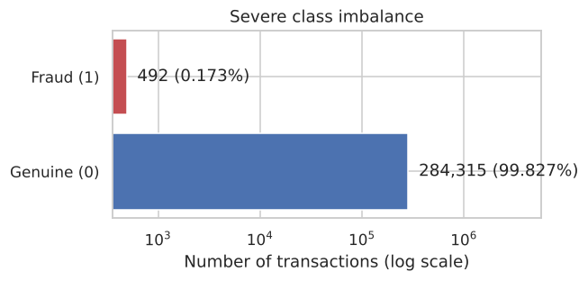
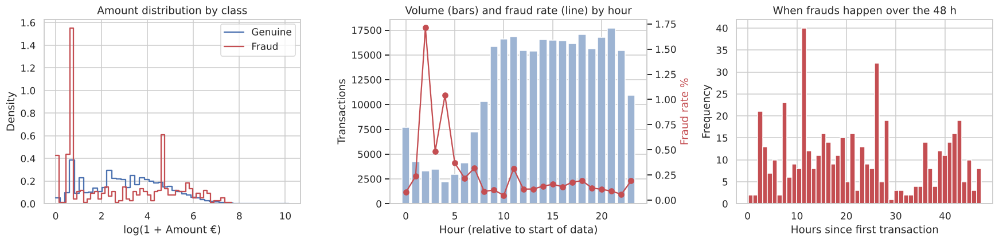
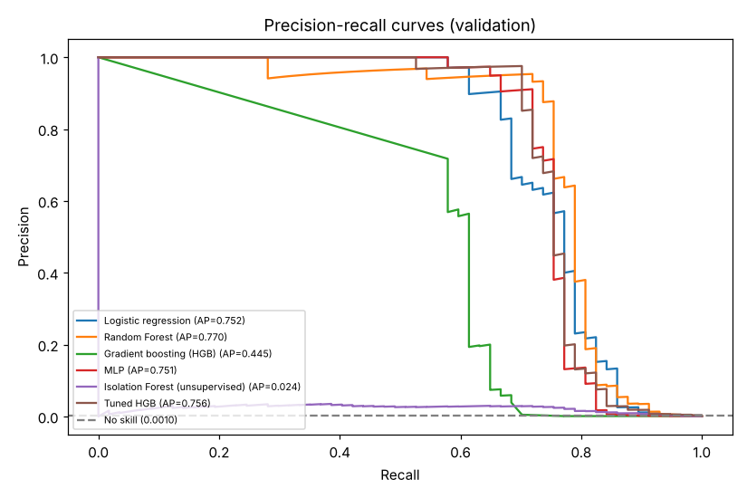
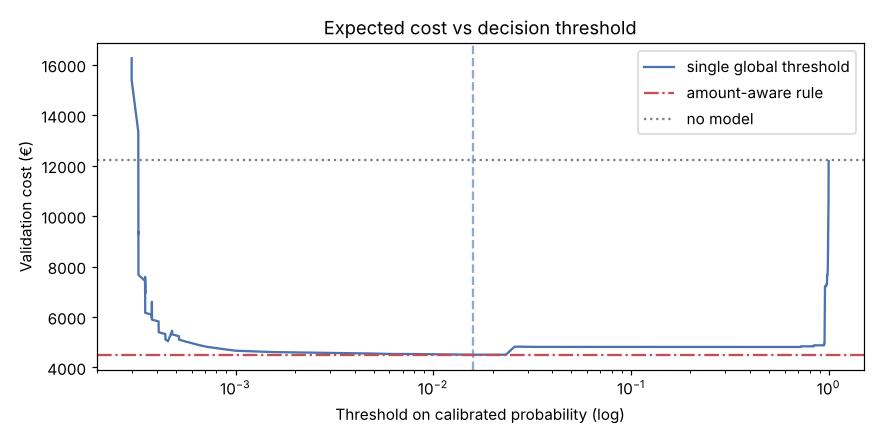
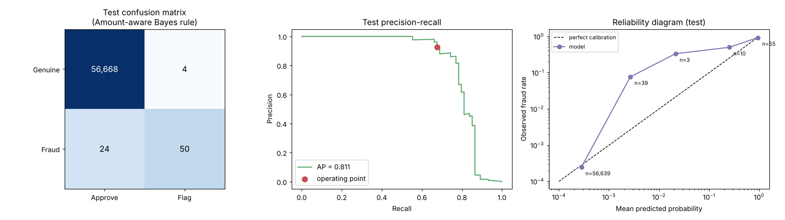
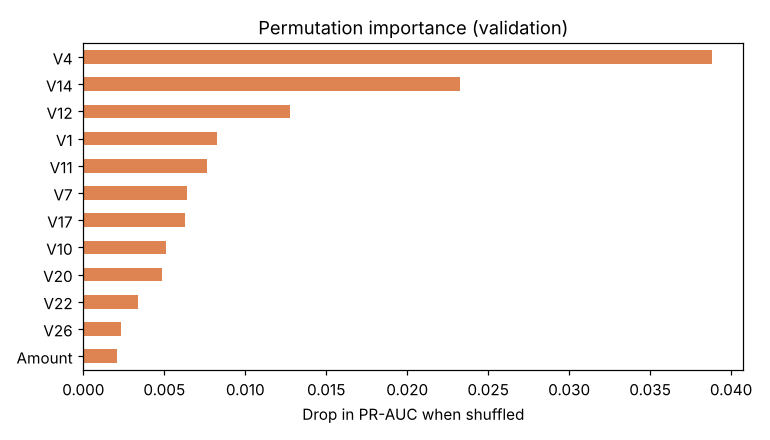
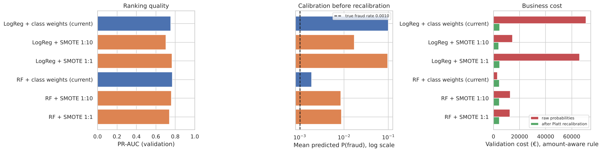
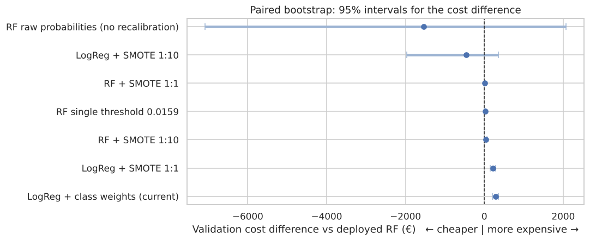
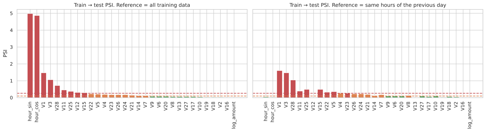

# Cost-Sensitive Credit-Card Fraud Detection: Final Report

**Millicent Jerotich Kemei, 224097**, DSA 8401 Applied Machine Learning

All numbers below are produced by the code in this repository (`python -m fraud.data && python -m fraud.train`,
seed 42), except Sections 4.6 and 6. Those come from the experiments in
`notebooks/fraud_detection_end_to_end.ipynb`, which use the same data, splits and models.

---

## Summary

A Random Forest, calibrated with Platt scaling and combined with an **amount-aware cost-optimal decision rule**,
catches **67.6%** of frauds in the untouched test period (newest 20% of transactions). **92.6%** of its alerts are
real fraud, and it avoids **68.5%** of fraud losses compared with having no model. It flags only 0.1% of
transactions. The decision rule mattered as much as the model: on the same model, the library-default 0.5
threshold caught almost the same number of frauds but avoided only 48.7% of losses, because it missed the
expensive ones. The system is packaged as a FastAPI service in Docker, deploys automatically from GitHub, and
includes Population Stability Index (PSI) drift monitoring.

---

## 1. Problem framing

**Business objective.** A card issuer wants to stop fraudulent transactions before money is lost, without burying
its analysts in false alarms or blocking genuine customers.

**ML task.** Supervised binary classification on tabular data. The model estimates P(fraud | transaction), and a
decision rule turns that probability into **REVIEW** or **APPROVE**.

**Data.** 284,807 European card transactions over two days in September 2013 (Kaggle `mlg-ulb/creditcardfraud`).
492 are fraud (**0.17%**). Features `V1`–`V28` are anonymised PCA components; `Time` (seconds since the first
transaction) and `Amount` (euros) are raw.

**Why accuracy is the wrong metric.** A model that approves everything is 99.83% accurate and catches nothing. On
our test set the final model's accuracy is 99.95%, only 0.08 points above that useless baseline. The project
therefore uses:

| Metric | Role |
|---|---|
| **PR-AUC** (average precision) | main ranking metric; focuses on the rare class. Chance level = fraud rate (about 0.001) |
| ROC-AUC | reported for completeness; flattering under heavy imbalance |
| Precision, recall | behaviour at the chosen operating point |
| **Expected cost (€)** | the business metric used to choose the decision rule |

**Cost structure** (an assumption, configurable in `configs/config.yaml`):

| Outcome | Cost |
|---|---|
| False alarm (genuine transaction flagged) | C_FP = €5 (analyst review and customer friction) |
| Missed fraud | the transaction amount |
| Correct decisions | €0 |

With a calibrated probability p, flagging costs (1 − p)·C_FP in expectation and approving costs p·Amount.
Flagging is cheaper when **p ≥ C_FP / (C_FP + Amount)**. The threshold therefore depends on the amount: about
0.005 for a €1,000 transaction, 0.5 for a €5 one.

## 2. Data and pipeline

**Validation** (`fraud.data.validate`). The pipeline checks columns, row count, missing values, label values and
amount sign before anything else runs. The original file passes: 284,807 rows, 0 missing values.

This check exists because of a real failure during development. An interrupted Colab upload loaded only 214,964
rows (75%), with one cut-off row. Every downstream result changed silently: a different model was selected, and
test PR-AUC fell to 0.578. The pipeline now stops with an explicit message in that situation.

**Cleaning.** There are 1,081 exact duplicate rows (19 of them frauds). Identical rows can land on both sides of a
split and inflate scores. A match across all 31 values to full precision is a data artefact, not a repeat
purchase, so duplicates are dropped **before** splitting.

**Exploration** (notebook, Step 2):

* Frauds are mostly small (median €9.25 vs. €22.00 for genuine transactions), but the minority of large frauds
  dominates the euro losses. This is why a missed fraud is costed at its amount.
* Fraud rates rise sharply at night, up to 1.7% of transactions at hour 2 against about 0.1% in the daytime.
  This motivated the hour-of-day features.

**Time-ordered split.** Oldest 60% → train (170,235 rows, 342 frauds), next 20% → validation (56,745 rows, 57
frauds), newest 20% → test (56,746 rows, 74 frauds). A random split would let the model learn from the future and
inflate every score. The time split mimics deployment: learn from the past, predict what comes next.

## 3. Methods and justification

### 3.1 Features
`FraudFeatures` (in `src/fraud/features.py`, imported by both training and the API, so there is no
training/serving skew) produces 31 features:
* `V1`–`V28`, unchanged;
* `log_amount = log(1 + Amount)`, a power transform that tames the heavy right tail;
* `hour_sin`, `hour_cos`, a cyclical encoding of the hour of day, so 23:00 and 00:00 sit close together.

Raw `Time` is dropped: it only counts seconds since the start of the data and would not generalise.

### 3.2 Model shortlist
One model per family, with sensible defaults, compared on validation PR-AUC:

| Model | Family | Imbalance handling | Validation PR-AUC | ROC-AUC |
|---|---|---|---|---|
| **Random Forest** | bagging ensemble | class weights | **0.770** | 0.957 |
| Gradient boosting, tuned | boosting ensemble | none (see 3.3) | 0.756 | 0.980 |
| Logistic regression | linear | class weights | 0.752 | 0.973 |
| MLP (64-32) | neural network | none | 0.751 | 0.912 |
| Gradient boosting, default | boosting ensemble | none | 0.445 | 0.737 |
| Isolation Forest | unsupervised anomaly detection | no labels used | 0.024 | 0.939 |
| Dummy (prior) | baseline | — | 0.001 | 0.500 |

* **Isolation Forest** shows why PR-AUC is the main metric. Its ROC-AUC of 0.939 looks strong, but its top alerts
  are almost all genuine (PR-AUC 0.024). Frauds here are unusual in *specific directions*, not generic outliers.
* **Default gradient boosting** stopped after 11 of 300 trees: early stopping, on by default above 10,000 rows,
  used a noisy signal given so few frauds. Even 300 trees only reached 0.475.

### 3.3 Tuning
Gradient boosting was tuned with `RandomizedSearchCV`: 12 candidates, scored by PR-AUC, using **`TimeSeriesSplit`**
(4 folds). Each fold validates on data later than its training data, and the whole pipeline is refitted inside each
fold, so nothing leaks. Early stopping was disabled.

The best configuration (CV PR-AUC 0.801) chose the most regularised option for three of the four complexity
settings: `min_samples_leaf=100`, `max_leaf_nodes=15`, `l2_regularization=1.0`. It raised validation PR-AUC from
0.445 to 0.756. Tuning stayed inside the training block and the result was then judged on separate validation
and test blocks. This gives the same protection against optimistic estimates as nested cross-validation, at much
lower cost.

### 3.4 Model selection with uncertainty
With 57 validation frauds, small gaps can be noise. A **paired stratified bootstrap** (1,000 resamples) of Random
Forest minus tuned gradient boosting gave ΔPR-AUC = +0.013, 95% CI [−0.023, +0.056]. The top models are
statistically tied. Random Forest was kept as the highest scorer; logistic regression would be a defensible,
faster and more explainable alternative.

### 3.5 Calibration
The cost rule needs **calibrated** probabilities. The Random Forest's raw mean predicted fraud rate was 0.18%,
against 0.10% observed in validation; the validation fraud rate was half the training rate, a label shift. Platt
(sigmoid) scaling was fitted on validation with the model frozen. It was chosen over isotonic regression because
two parameters are more stable with fewer than 100 positives. Mean prediction moved to 0.10%, matching the
observed rate, and the Brier score improved from 0.000346 to 0.000330.

### 3.6 Choosing the decision rule
Four rules were compared by **euro cost on validation**:

| Rule | Alerts | Recall | Fraud € caught | Cost | Saving |
|---|---|---|---|---|---|
| Default 0.5 | 41 | 68.4% | 60.7% | €4,811 | 60.7% |
| **Amount-aware rule** | 38 | 63.2% | 63.4% | **€4,487** | **63.3%** |
| Best single threshold (0.0159) | 49 | 75.4% | 63.4% | €4,505 | 63.2% |
| Max-F2 threshold (0.0159) | 49 | 75.4% | 63.4% | €4,505 | 63.2% |
| No model | 0 | 0% | 0% | €12,231 | 0% |

The amount-aware rule was cheapest and has **no tuned parameters**: it follows directly from the cost assumptions,
so it cannot overfit the 57 validation frauds. The cost curve is flat between thresholds of about 0.001 and 0.02,
so the choice is robust.

## 4. Results

### 4.1 Test set: evaluated once, after every choice was frozen

| Metric | Estimate | 95% bootstrap CI |
|---|---|---|
| PR-AUC | 0.811 | 0.727 – 0.888 |
| ROC-AUC | 0.958 | 0.920 – 0.987 |
| Recall | 0.676 (50 / 74) | 0.554 – 0.784 |
| Precision | 0.926 (50 / 54) | 0.854 – 0.981 |
| Fraud losses avoided | 68.5% | 41.7% – 93.8% |

### 4.2 The decision rule matters as much as the model

| Rule (test) | Recall | Fraud € caught | Cost | Saving |
|---|---|---|---|---|
| Default 0.5 | 68.9% | 49.0% | €3,962 | 48.7% |
| **Amount-aware (chosen)** | 67.6% | 68.8% | **€2,432** | **68.5%** |
| Best single threshold | 77.0% | 68.9% | €2,451 | 68.3% |
| No model | 0% | 0% | €7,728 | 0% |

The default threshold catches about as many frauds but misses the expensive ones. Catching *more* frauds is not
the same as saving *more money*.

### 4.3 Error analysis

| Fraud amount | Caught | Total | € missed |
|---|---|---|---|
| €0–1 | 19 | 28 | €3.76 |
| €1–10 | 9 | 16 | €39.77 |
| €10–100 | 11 | 15 | €92.18 |
| €100–500 | 9 | 11 | €545.06 |
| €500+ | 2 | 4 | €1,731.29 |

Most misses are deliberate: small frauds, where reviewing every similar-scoring genuine transaction would cost more
than the fraud. The two missed frauds over €500 (€1,731 in total) are the cases to investigate. They may represent
a pattern absent from the training period.

### 4.4 What drives the model
Permutation importance (drop in validation PR-AUC when a feature is shuffled) ranks **V4, V14, V12, V1, V11** highest.

### 4.5 Calibration on test
The model is well calibrated where almost all transactions sit, at very low scores. In the middle range the
observed fraud rate is *above* the prediction, so the model is slightly under-confident. That is consistent with the test fraud rate
(0.13%) being higher than the validation rate the calibrator was fitted on (0.10%). In production, recalibrate on
a rolling recent window.

### 4.6 Would SMOTE have helped? (notebook Section 6.3)
The usual advice is to adjust the decision threshold first and to resample only if the *ranking* is the weak link.
SMOTE was tested anyway, inside an `imblearn` pipeline so that only training data is resampled:

* **Ranking:** no reliable gain for the Random Forest (1:10: −0.008, within noise; 1:1: −0.030). For logistic
  regression, 1:1 helped slightly (+0.013) and 1:10 hurt (−0.046). No SMOTE variant beat the selected model.
* **Probabilities:** SMOTE inflated the Random Forest's mean predicted fraud rate about 9× (0.85% vs. 0.10%
  observed). Class weighting did the same to logistic regression, about 100×. Uncalibrated, class-weighted
  logistic regression would cost €71,002 on validation, almost 6× more than no model. After recalibration all
  variants cost €4,000–4,800.
* **Cost bootstrap** (2,000 paired resamples): no alternative was reliably cheaper than the deployed model.

* **Training time:** SMOTE 1:1 tripled Random Forest training time (187 s vs. 60 s).
* **Resampling before splitting** (the classic leakage mistake) inflated ROC-AUC from 0.968 to 0.989, because
  98% of the "test" frauds were synthetic copies built from the training frauds.

Conclusion: class weighting plus calibration plus the cost-optimal threshold was kept.

## 5. Deployment and MLOps

* **Deployable unit = decision function.** `artifacts/fraud_model.joblib` bundles the feature pipeline, model,
  calibration, decision policy, cost parameter, metadata (library versions, seed, data window, test metrics) and
  the PSI reference profile.
* **API** (`app/main.py`, FastAPI): `/score`, `/drift`, `/demo`, `/model-info`, `/health` and auto-generated
  `/docs`. Inputs are validated by Pydantic: a negative amount or a missing field returns HTTP 422.
* **Docker:** a multi-stage `Dockerfile` with a `train` target that runs the pipeline and a small, non-root `api`
  target with a health check. `docker-compose.yml` wires both, with volumes for data and artifacts.
* **Reproducibility:** all settings live in `configs/config.yaml`; dependencies are pinned; the seed is fixed;
  the input file is validated; and its SHA-256 is recorded in `data/processed/data_report.json`.
* **CI/CD:** GitHub Actions runs 18 tests on every push (`ci.yml`) and deploys to Modal on every push to `main`
  (`modal-deploy.yml`). Render and Railway configurations are included as alternatives.

## 6. Monitoring (notebook Step 8)

* **Train → test PSI** flags the hour features (PSI ≈ 5). This is a coverage artefact: the test period covers only
  16:00–23:59. Against the *same hours* of the previous day, those features are stable.
* V1, V3 and V28 shift **even against the same hours**: day 2 genuinely differs from day 1. Yet test PR-AUC (0.81)
  was no worse than validation (0.77). Input drift is not the same as degraded decisions, so alerts should be
  prioritised by feature importance and paired with output monitoring.
* **Simulated incident** (amounts × 3, V14 − 0.8): PSI flagged exactly `V14` (1.05) and `log_amount` (0.61), and the
  alert count rose from 54 to 70. For rare-event models, the **alert rate** is a more sensitive output signal than the mean score.

## 7. Limitations

1. **Two days of data from one issuer, from 2013.** Fraud tactics change; results may not transfer. The test set holds only
   74 frauds, hence the wide confidence intervals (e.g. losses avoided: 42%–94%).
2. **Costs are assumptions.** €5 per false alarm is not measured. The cost bootstrap showed that a cheaper-looking
   alternative (uncalibrated probabilities: 504 alerts instead of 38) breaks even at about €8 per alarm.
   Re-estimating C_FP from operations matters more than any modelling choice tested.
3. **Anonymised features.** V1–V28 are PCA components, so explanations have no business meaning, and behavioural
   features (card velocity, merchant history) cannot be engineered.
4. **No per-card history:** each transaction is scored independently.
5. **Delayed labels.** Chargebacks arrive weeks later; live precision and recall are not observable immediately.
6. **Single calibration window:** the calibrator is fitted once; the test reliability diagram suggests it should be
   refreshed on recent data.
7. **Same data for calibration and policy choice.** Validation was used both to calibrate and to choose the rule.
   This is mitigated by judging only on the untouched test set and by choosing a rule with no tuned parameters.

## 8. Future work
* Collect months of data with card identifiers; add velocity and merchant features; re-estimate costs from operations.
* Track experiments with MLflow and add a champion/challenger promotion step on a recent out-of-time window.
* Recalibrate on a rolling window and alert on score PSI and alert rate as well as input PSI.
* Bootstrap the cost difference whenever a challenger is considered, as done in Section 4.6.
